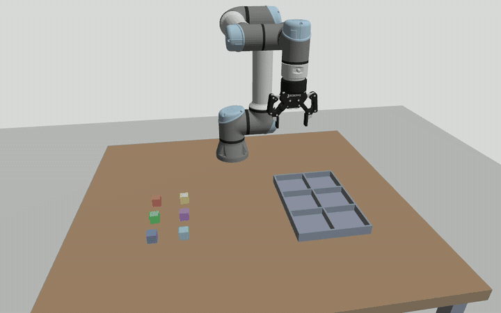
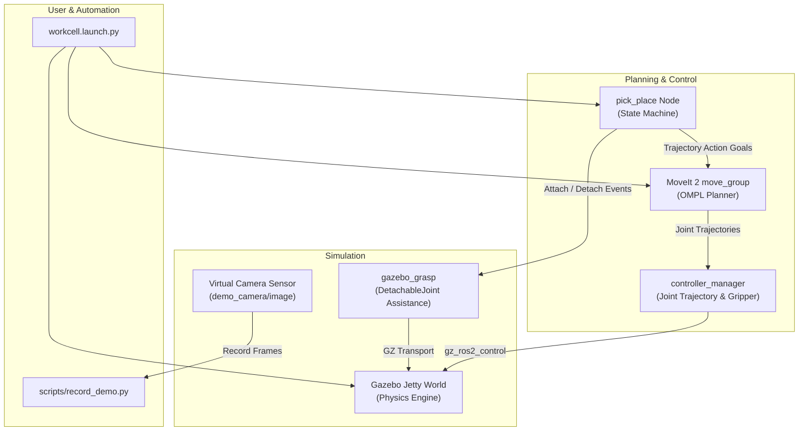

# UR5e Tray Workcell (ROS 2 & Gazebo)

[](https://docs.ros.org/)
[](https://gazebosim.org/)
[](https://moveit.ai/)
[](https://ubuntu.com/)
[](LICENSE)
[](https://python.org)

An end-to-end, production-grade robotics workcell demonstration featuring a **Universal Robots UR5e** manipulator equipped with a **Robotiq 2F-85** adaptive gripper. The robot plans collision-free trajectories using **MoveIt 2** to pick six colored blocks from a workbench and precisely place them into a designated 2 × 3 compartmentalized tray inside **Gazebo Jetty** simulation.

---

## 🎬 Demo



> *Full high-definition video available at [`assets/demo.mp4`](assets/demo.mp4).*

---

## 🌟 Key Features

- **Industrial Hardware Pairing**: 6-DOF UR5e manipulator coupled with a 2-finger Robotiq 2F-85 gripper with custom mounting adapter and kinematic mimic joint configuration.
- **Collision-Aware Motion Planning**: Full scene representation in MoveIt 2 (table, obstacles, tray walls, internal dividers) with OMPL motion planner preventing collisions during pick, carry, and drop phases.
- **Deterministic Workcell Automation**: State-machine sequence managing approach vectors, Cartesian insertion paths, dynamic grasp attachments, lift clearances, and return-to-home motions.
- **Dual Simulation Modes**:
  - **Interactive GUI**: Gazebo Jetty physics window + RViz 2 visualization showing planning scene and robot kinematics.
  - **Headless Automated Testing**: Background execution returning structured YAML metrics for CI/CD pipelines and regression testing.
- **Built-in Demo Recording**: Automated headless recording tool capturing simulator camera frames at 15 fps and exporting palette-optimized GIF and H.264 MP4 videos.
- **Clean Architecture & 100% Python Control**: Application logic decoupled across modular Python components (`layout.py`, `moveit_client.py`, `gazebo_grasp.py`, `pick_place.py`).

---

## 🏗️ System Architecture



---

## 📋 Prerequisites & Requirements

- **Operating System**: Ubuntu 24.04 / 26.04
- **ROS 2**: Lyrical or Rolling
- **Physics Simulation**: Gazebo Jetty (GZ Sim 10)
- **Motion Planning**: MoveIt 2
- **Python**: 3.12+

---

## 🚀 Quickstart

### 1. Clone Repository

```bash
git clone https://github.com/DuyenNH2401/Ur5e-Pick-And-Place-ROS2.git
cd Ur5e-Pick-And-Place-ROS2
```

### 2. Install Dependencies

```bash
# Sourcing ROS 2 environment
source /opt/ros/lyrical/setup.bash

# Install ROS 2 package dependencies
rosdep install --from-paths src --ignore-src --rosdistro lyrical -y

# Install Python tooling dependencies
pip install -r requirements.txt
```

### 3. Build Workspace

```bash
colcon build --symlink-install
source install/setup.bash
```

### 4. Run Interactive Demo (Gazebo + RViz)

```bash
ros2 launch tray_workcell workcell.launch.py
```

Both Gazebo and RViz 2 will launch. The robot will pick each of the 6 blocks and sort them into their destination tray slots, returning to the home position upon completion. Results are saved to `/tmp/tray-workcell-result.yaml`.

### 5. Run Headless Verification (No GUI)

Ideal for automated test runs or remote servers:

```bash
python3 scripts/run_headless.py
```

Outputs `PASS` when all 6 objects are confirmed inside their target compartments. Logs and coordinates are stored in `.runtime/<timestamp>/`.

### 6. Record New Demo Video & GIF

```bash
python3 scripts/record_demo.py
```

Runs the simulation headless with a virtual 3D camera, recording frames and generating `assets/demo.mp4` and `assets/demo.gif`.

---

## ⚙️ Configuration

All workcell parameters can be customized in [`src/tray_workcell/config/workcell.yaml`](src/tray_workcell/config/workcell.yaml):

```yaml
world: tray_workcell
table:
  center: [0.35, 0.0]
  size: [1.1, 1.2]
  height: 0.75
robot:
  base: [0.0, 0.0, 0.75]
  home: [0.0, -1.5708, 1.5708, -1.5708, -1.5708, 0.0]
tray:
  center: [0.45, 0.26]
  rows: 2
  columns: 3
  cell_size: [0.12, 0.12]
```

- **Tray Slots**: Numbered row-by-row:
  - Row 0 (−Y side): `0`, `1`, `2`
  - Row 1 (+Y side): `3`, `4`, `5`
- **Object Targets**: Change `slot` inside `objects[]` to rearrange which compartment each block is placed into.

---

## 🧪 Testing

Run unit tests verifying URDF integrity, collision models, kinematics parameters, and layout mathematics:

```bash
source install/setup.bash
python3 -m pytest tests -q
```

Expected result:
```text
........... [100%]
11 passed in 0.75s
```

---

## 📂 Project Structure

```text
.
├── assets/                       # Demo media (GIF, MP4)
│   ├── demo.gif
│   └── demo.mp4
├── docs/                         # Technical notes and source attribution
│   └── sources.md
├── scripts/                      # Utility scripts
│   ├── run_headless.py           # Automated test execution
│   └── record_demo.py            # Simulation recorder (camera to GIF/MP4)
├── src/
│   ├── robotiq_description/      # Robotiq 2F-85 & 2F-140 description & meshes
│   └── tray_workcell/            # Main ROS 2 package
│       ├── config/               # Workcell YAML, controllers, MoveIt OMPL configs
│       ├── launch/               # ROS 2 launch files
│       ├── rviz/                 # RViz display configurations
│       ├── tray_workcell/        # Python module implementation
│       │   ├── gazebo_grasp.py   # Gazebo dynamic grasp plugin bridge
│       │   ├── launch_config.py  # Runtime SDF/URDF generator
│       │   ├── layout.py         # Geometry model generator
│       │   ├── moveit_client.py  # MoveIt action & service client
│       │   └── pick_place.py     # Main state-machine sequence
│       └── urdf/                 # System Xacro assemblies
├── tests/                        # Pytest suite
├── .github/workflows/ci.yml      # GitHub Actions CI
├── .gitignore                    # Comprehensive ROS 2 & Python ignore rules
├── CONTRIBUTING.md               # Contribution guidelines
├── LICENSE                       # BSD 3-Clause License
├── package.xml                   # Root workspace manifest
└── requirements.txt              # Python requirements
```

---

## 💡 Troubleshooting & Notes

- **Clean Shutdown Logs**: At the end of a headless run, MoveIt and `ros_gz_bridge` process terminations may log cleanup warnings as the ROS 2 executor tears down nodes. This does not affect execution success; check `result.yaml` for actual placement status.
- **Display Server**: The project supports native Wayland and X11 on Ubuntu 24.04/26.04.

---

## 📜 License & Acknowledgments

- **Core Code**: Released under the [BSD 3-Clause License](LICENSE).
- **Robot Descriptions**:
  - `ur_description`: [Universal Robots ROS 2 Description](https://github.com/UniversalRobots/Universal_Robots_ROS2_Description).
  - `robotiq_description`: [PickNik Robotics ros2_robotiq_gripper](https://github.com/PickNikRobotics/ros2_robotiq_gripper).
